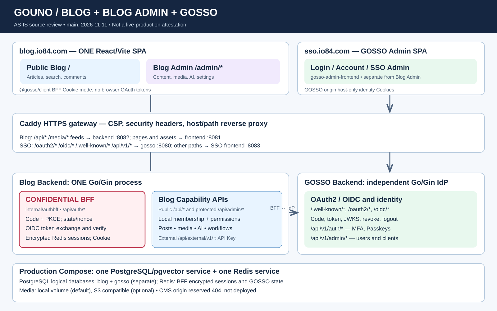

# Gouno Blog / Blog Admin / GOSSO — current As-Is architecture

> **Source snapshot:** main as reviewed 2026-11-11: gouno-blog `c945ad8`, gosso `95fde42`, gosso-admin `364eee6`, gosso-client `aa5c35e`. This documents reviewed source and deployment templates, **not independently verified live production state**.

## Application and identity boundaries

| Component | Code location | Current role |
| --- | --- | --- |
| Public Blog and Blog Admin | [blog-frontend/src/App.tsx](../../blog-frontend/src/App.tsx) | **One React/Vite SPA**, two groups of routes (`/` and `/admin/*`), not two independently deployed frontends. |
| Frontend identity/transport | [blog-frontend/src/auth.ts](../../blog-frontend/src/auth.ts), [src/api/client.ts](../../blog-frontend/src/api/client.ts) | `@gosso/client` in BFF Cookie mode; `apiClient` adds narrowly scoped Recent MFA step-up/retry. Browser code never receives OAuth access, refresh or ID tokens. |
| Confidential BFF | [blog-backend/internal/authbff](../../blog-backend/internal/authbff) | **A module inside the same Go/Gin process as the Blog API**. Handles login, code callback, PKCE, state, nonce, ID Token verification, Redis/AEAD session storage, refresh, logout and step-up. |
| Blog domain API | [blog-backend/router/web.go](../../blog-backend/router/web.go), [internal/access](../../blog-backend/internal/access) | Public content routes and authenticated Admin routes. Local `(issuer, subject)` principal, membership and permissions are authoritative for Blog actions; GOSSO admin role is not automatic Blog authorization. |
| SSO frontend | [gosso-admin](https://github.com/rushairer/gosso-admin/blob/main/gosso-admin-frontend/src/App.tsx) | Separate React frontend serving SSO login, account settings and SSO administration. **Not** Blog Admin. |
| SSO backend | [gosso](https://github.com/rushairer/gosso/blob/main/router/web.go) | Independent Go/Gin identity provider with `/.well-known/*`, `/oauth2/*`, `/oidc/*`, `/api/v1/*`. |
| HTTPS reverse proxy | [Caddyfile.production](../../Caddyfile.production) | Blog origin: `/api/*`, media/feed/sitemap → `blog-backend:8082`; other routes → `blog-frontend:8081`. SSO origin: identity protocol/API → `gosso:8080`; UI → `gosso-admin-frontend:8083`. |
| Data infrastructure | [docker-compose.production.yml](../../docker-compose.production.yml), [init.sql](../../init.sql) | One PostgreSQL/pgvector service with **separate logical `blog` and `gosso` databases**, plus a shared Redis service with application isolation. Media defaults to a local volume; optional S3-compatible storage. |

## Actual login and authorization flow

1. On `blog.<domain>`, the Blog SDK navigates to same-origin `GET /api/auth/login` when Blog authentication is required.
2. The Blog Go BFF creates server-side PKCE verifier, state and nonce, stores the temporary flow in Redis, and redirects the **browser** to GOSSO `/oauth2/authorize`.
3. The GOSSO frontend handles credential/MFA UI. The browser returns an authorization code to the **Blog Go backend** at `GET /api/auth/callback` — **not** a React `/callback` route.
4. The BFF performs the code exchange with GOSSO **server-to-server**, verifies the ID Token, stores OAuth tokens server-side in an AEAD-encrypted Redis session and sets an opaque host-only HttpOnly Cookie on the Blog origin.
5. Blog browser APIs are same-origin. BFF middleware projects verified identity; Blog-local access middleware checks active membership and the permission required by the specific API. Unsafe browser methods are subject to the `__Host-blog-csrf` cookie/header check.
6. Refresh, local/RP-initiated logout, back-channel logout and recent MFA step-up have dedicated BFF implementations. Code presence is not a substitute for representative runtime tests.

The `/api/external/v1/*` machine-to-machine endpoint has its own API-key boundary, not browser BFF login. `Caddyfile.production` reserves the CMS hostname with an explicit **404**; this is not a running CMS service.

## Change and verification policy

The production Compose template is **not proof of actual production rollout**. Do not infer separate Blog Admin deployment, separate BFF microservice, CDN/SSR, physically independent PostgreSQL clusters or runtime operational readiness. Before revising this chart, compare `App.tsx`, `auth.ts`, `internal/authbff`, `router/web.go`, Caddy, Compose, database initialization and the corresponding GOSSO repositories.

Security policy: [OIDC/BFF ADR](../oidc-bff-split-adr.md), [identity client boundary](../auth-client-boundary.md). Historical dated audit files must remain historical records rather than silently rewritten evidence.
